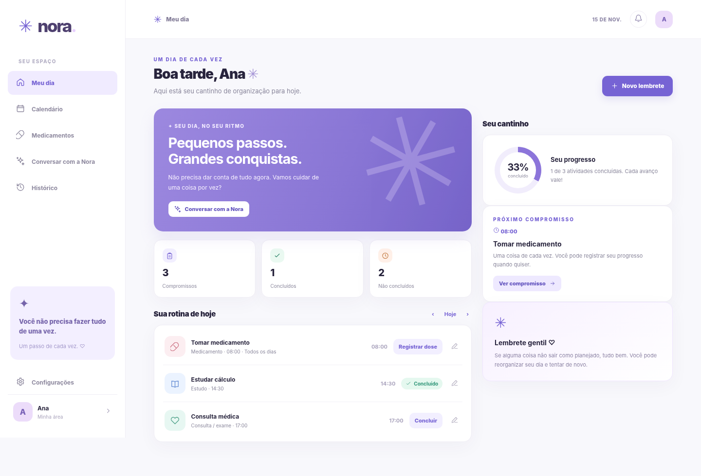
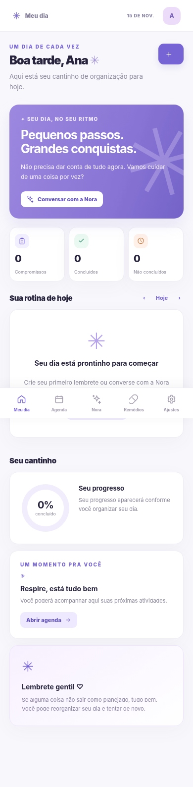
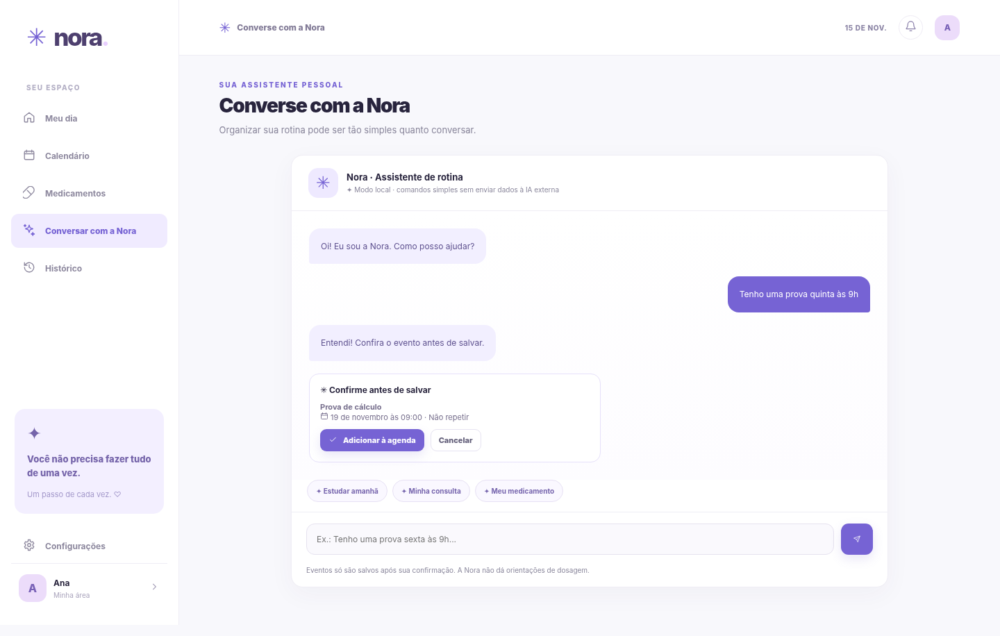
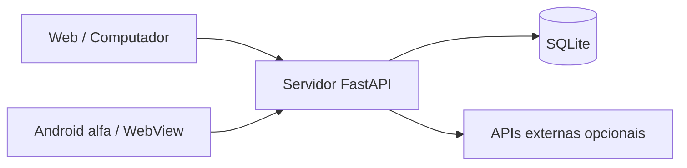

<div align="center">
  <h1>✳ Nora</h1>
  <p><strong>Organização pessoal, acessibilidade e bem-estar em uma só experiência</strong></p>
  <p><strong>Desenvolvimento e programação: Sarah Belchior</strong></p>
  <p>Web responsiva · Python/FastAPI · JavaScript · SQLite · Android (alfa)</p>
  <p>Protótipo em evolução, com demonstração pública e executável para avaliação técnica.</p>
  <p><a href="#-demonstração-executável">▶ Testar a demonstração</a> · <a href="#-estrutura-do-repositório">💻 Ver o código</a> · <a href="images/nora-dashboard-preview.png">📷 Ver as telas</a></p>
</div>

---

## ✨ Sobre a Nora

A **Nora** é uma aplicação que estou desenvolvendo para reunir **tarefas, agenda, estudos, rotinas e ferramentas de apoio** em uma interface mais clara, personalizável e acessível. O projeto combina uma aplicação web para computador e celular com um protótipo Android conectado ao servidor.

A proposta é reduzir a fragmentação das ferramentas de organização e oferecer uma experiência que respeite diferentes necessidades de uso.

### 🖥️ Interface do projeto

<p align="center">
  
</p>

<p align="center">
  
  &nbsp;&nbsp;
  
</p>

<sub>Imagens de versões e prévias do protótipo, não de um aplicativo publicado em loja.</sub>

---

## 🚀 Demonstração executável

Para que outras pessoas possam **avaliar a programação**, disponibilizei uma versão **reduzida, local e independente** da Nora. Não é o aplicativo privado completo: ela exemplifica um fluxo de organização de tarefas e modo foco, usando dados fictícios.

| Na demonstração é possível... | Evidência técnica |
| --- | --- |
| Criar, listar, concluir e excluir tarefas | Rotas REST em **FastAPI** |
| Organizar tarefas por categoria e data | Validação e regras de negócio |
| Manter tarefas após recarregar a página | **SQLite** e persistência local |
| Consultar uma interface adaptável | **HTML, CSS e JavaScript** |
| Usar um temporizador de foco | Lógica e interação no frontend |
| Examinar e testar os endpoints | Documentação interativa em **`/docs`** |

### 1. Executar no Windows

**Pré-requisito:** Python instalado no computador.

1. Clique em **Code → Download ZIP** neste repositório e extraia os arquivos.
2. Abra a pasta extraída e dê dois cliques em **`INICIAR_DEMO_WINDOWS.bat`**.
3. Quando o servidor iniciar, abra **http://127.0.0.1:8000** no navegador.

### 2. Executar pelo terminal (Windows, macOS ou Linux)

Na raiz deste repositório:

```bash
python -m pip install -r requirements-dev.txt
python -m uvicorn demo.main:app --host 127.0.0.1 --port 8000
```

| Endereço | Conteúdo |
| --- | --- |
| http://127.0.0.1:8000 | Interface demonstrativa |
| http://127.0.0.1:8000/docs | API REST interativa (Swagger UI) |

### 3. Executar os testes

```bash
python -m pytest -q tests
```

Os testes cobrem respostas da API, criação e atualização de tarefas, validação de entradas, persistência e acesso à interface. Também há uma configuração de testes em [`.github/workflows/tests.yml`](.github/workflows/tests.yml).

> **Segurança:** a demonstração não tem autenticação e foi criada **somente para uso local**. Não a publique como servidor aberto na internet e não insira dados pessoais ou de saúde. Um banco de exemplo é criado automaticamente em `instance/`.

---

## 🧩 Minha atuação no desenvolvimento

Participo da **programação, estruturação, integração e evolução da Nora**, trabalhando com frontend e backend, configuração do ambiente, testes e resolução de problemas reais.

- **Backend e dados:** Python, FastAPI, rotas de API e persistência com SQLite.
- **Frontend:** JavaScript, HTML e CSS; criação e refinamento de interfaces responsivas.
- **Integrações:** configuração de serviços externos e separação das credenciais do código acessível ao usuário.
- **Android:** configuração do projeto, Gradle, emulador e comunicação com o servidor da aplicação.
- **Qualidade:** testes funcionais, investigação de erros, ajustes de acessibilidade e organização de funcionalidades.

Uso ferramentas de IA como apoio durante o desenvolvimento e a revisão de algumas implementações, além do meu trabalho de programação, integração, configuração e validação.

### Tecnologias do projeto

| Camada | Tecnologias / conceitos |
| --- | --- |
| Backend | Python, FastAPI, APIs REST |
| Frontend | JavaScript, HTML, CSS, interface responsiva |
| Persistência | SQLite |
| Aplicativo Android (alfa) | Java, WebView, Android Studio, Gradle |
| Qualidade | Pytest, testes funcionais, GitHub Actions na demo |

### Arquitetura geral



Na versão Android alfa, **o servidor Python não roda dentro do telefone**: o aplicativo se comunica com o servidor configurado.

---

## 🗂️ Estrutura do repositório

```text
nora-case-study/
├── README.md                     # Visão geral e documentação
├── demo/                         # Backend e frontend executáveis
│   ├── main.py                   # API FastAPI
│   └── static/                   # Interface HTML, CSS e JavaScript
├── tests/                        # Testes automatizados
├── examples/                     # Trechos do menu móvel da Nora
├── images/                       # Capturas de interface
├── .github/workflows/tests.yml   # Automação de testes
├── requirements.txt              # Dependências de execução
├── requirements-dev.txt          # Dependências para testes
└── INICIAR_DEMO_WINDOWS.bat      # Inicialização local no Windows
```

**Código para explorar:** [`demo/main.py`](demo/main.py) · [`demo/static/app.js`](demo/static/app.js) · [`tests/test_demo.py`](tests/test_demo.py) · [`examples/`](examples/)

---

## 💜 Recursos da Nora em desenvolvimento

Além do recorte publicado na demo, o projeto principal explora:

- Agenda, tarefas, lembretes e ferramentas para estudos;
- recursos assistidos por inteligência artificial;
- personalização da interface e opções de acessibilidade;
- biblioteca Nora Sleep, sons demonstrativos e playlists pessoais;
- sincronização entre dispositivos que utilizam o mesmo servidor;
- rotinas de backup e melhorias de segurança.

**Estado do projeto:** protótipo em evolução. A demo não oferece todas essas funcionalidades; os recursos de saúde não substituem assistência profissional. O aplicativo Android ainda não está publicado em loja.

---

## 🎯 O que aprendi construindo a Nora

O desenvolvimento envolveu desafios de integração frontend/backend, persistência de dados, configuração de dependências, diferenças entre navegador e WebView, testes em emulador Android e validação de informações como fuso horário. O projeto continua evoluindo a partir de testes e do feedback sobre a experiência de uso.

---

<p align="center"><strong>Desenvolvimento e programação: Sarah Belchior</strong></p>
<p align="center"><a href="https://github.com/sarahbelchior">Voltar ao meu perfil no GitHub</a></p>
