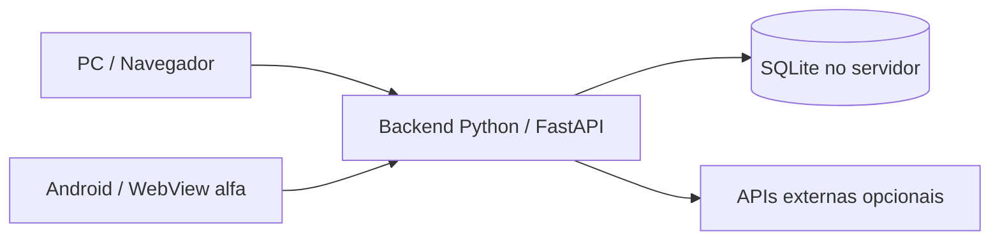
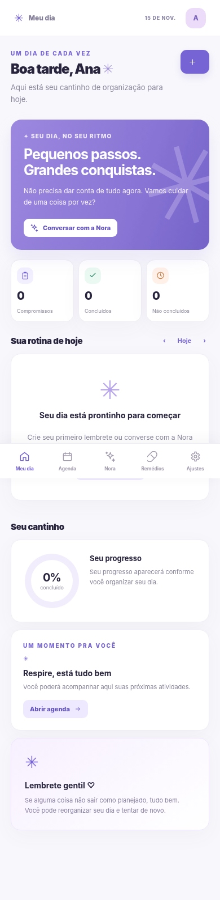

# 💜 Nora — Assistente digital acessível

**Desenvolvimento e programação: Sarah Belchior** · **Status: protótipo em evolução**

## Visão geral

A **Nora** é uma aplicação de organização pessoal, acessibilidade e bem-estar em evolução, reunindo agenda, tarefas, ferramentas de apoio, recursos assistidos por IA e funcionalidades de rotina. A interface é web responsiva para computador e celular, com um protótipo Android em **Java/WebView** que se conecta ao servidor configurado.

## O problema

Recursos de agenda, rotina, estudos e autocuidado podem estar fragmentados entre serviços; sua interface pode dificultar o uso por pessoas que precisam de maior clareza ou personalização. A Nora explora um ambiente único e mais adaptável.

## Minha participação técnica

Atuo no desenvolvimento, programação, configuração e evolução do software. Trabalhei no código e na integração entre **Python/FastAPI**, **JavaScript/HTML/CSS**, **SQLite**, **APIs externas** e a versão experimental Android. Também depurei erros reais no Android Studio e no servidor, incluindo configuração do Gradle, acesso do emulador ao computador e validação de fuso horário. Participo da definição das funcionalidades, organização dos fluxos e testes.

O projeto recebe assistência de ferramentas de IA em partes da implementação e revisão, além do meu trabalho de programação, configuração, validação, decisões e refinamento.

## Arquitetura

> O Android alfa **não roda o servidor Python dentro do aparelho**. Para testar com dados compartilhados, ele precisa apontar ao mesmo servidor. A implementação HTTPS é a abordagem prevista para uso fora do emulador.

## Recursos explorados

- Agenda, tarefas, lembretes, estudos e organização de rotinas;
- assistente com recursos de IA e integrações opcionais;
- navegação responsiva e menu lateral adaptado ao celular;
- modos e preferências de acessibilidade;
- Nora Sleep: biblioteca de sons demonstrativos, playlists pessoais e temporizador;
- contas, persistência, backups e experimentos de sincronização por servidor;
- testes funcionais e documentação de uso.

## Evidência de código

A pasta [`examples/`](examples/) contém **dois arquivos reais** do módulo de navegação móvel da Nora (JavaScript e CSS), retirados da versão de revisão que compartilhei para este portfólio. É um recorte demonstrativo de interface; não é o aplicativo completo e não deve ser executado sozinho.

## Capturas da interface

<table><tr><td width="62%"></td><td width="38%"></td></tr></table>

Imagens de prévias do protótipo em desenvolvimento, não prova de operação pública ou validação clínica.

## Aprendizados e decisões de engenharia

- Integração frontend/backend e validação de dados;
- investigação de erros reais, logs e testes no emulador;
- separação das chaves de API do código cliente;
- limitações de PWA, WebView e notificações Android;
- escolhas de acessibilidade e evolução incremental por feedback.

## Limitações e segurança

**Projeto experimental, sem homologação clínica ou publicação em loja.** Recursos de saúde não substituem atendimento médico. A sincronização exige o mesmo servidor; notificações nativas e funcionamento offline completo não estão concluídos. Por privacidade, este repositório apresenta apenas um estudo de caso e módulos visuais públicos, sem banco de dados, autenticações, segredos, chaves ou código de servidor completo.

[← Voltar ao perfil](https://github.com/sarahbelchior) · [Ver site-portfólio](https://sarahbelchior.github.io/portfolio-sarah-belchior/)
