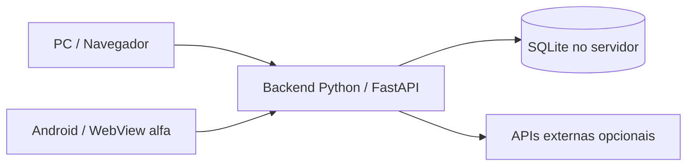
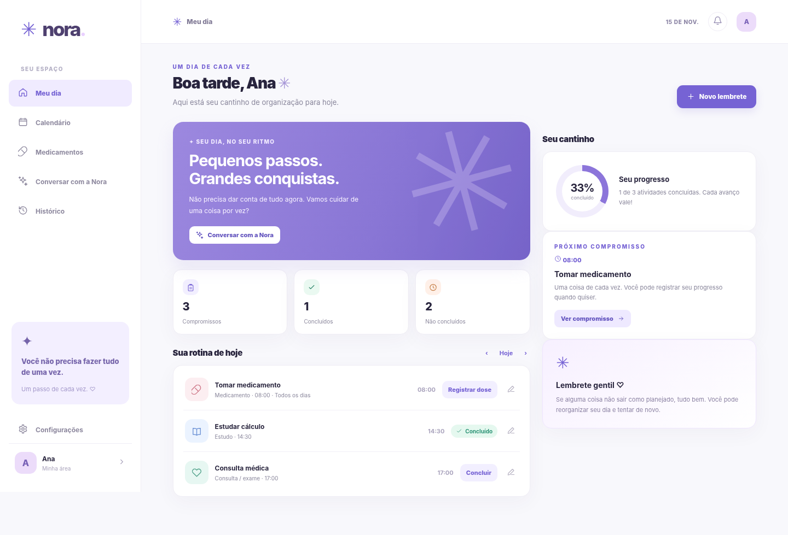

💜 Nora — Assistente digital acessível
Desenvolvimento e programação: Sarah Belchior · Status: protótipo em evolução · Demonstração executável pública disponível

▶ Teste uma demonstração executável da Nora
Agora há código que pode ser executado e avaliado: a pasta [`demo/`](demo/) contém uma versão local, simplificada e segura, com frontend responsivo, backend Python/FastAPI, persistência SQLite e testes. Ela demonstra um recorte de organização de tarefas e modo foco, e não corresponde ao aplicativo privado completo.

Windows (mais simples): baixe o código, extraia e execute INICIAR_DEMO_WINDOWS.bat (Python instalado). Depois, abra http://127.0.0.1:8000.

Terminal (Windows, macOS ou Linux):
python -m pip install -r requirements-dev.txt
python -m uvicorn demo.main:app --host 127.0.0.1 --port 8000
Acesse http://127.0.0.1:8000 (interface) e http://127.0.0.1:8000/docs (API interativa). Para executar os testes:
python -m pytest -q tests
O que avaliar na demonstração: criar uma tarefa, definir categoria/data, concluir, excluir, conferir contadores, navegar por agenda e testar o cronômetro de foco. O SQLite é criado localmente em instance/ com dados fictícios. Há um workflow de testes na pasta [`.github/workflows`](.github/workflows/tests.yml).
Limitação importante: este pequeno exemplo não possui autenticação nem integrações externas. Execute apenas localmente e não o exponha na internet; não armazene dados pessoais ou de saúde nele.

Visão geral
A Nora é uma aplicação de organização pessoal, acessibilidade e bem-estar em evolução, reunindo agenda, tarefas, ferramentas de apoio, recursos assistidos por IA e funcionalidades de rotina. A interface é web responsiva para computador e celular, com um protótipo Android em Java/WebView que se conecta ao servidor configurado.
O problema
Recursos de agenda, rotina, estudos e autocuidado podem estar fragmentados entre serviços; sua interface pode dificultar o uso por pessoas que precisam de maior clareza ou personalização. A Nora explora um ambiente único e mais adaptável.
Minha participação técnica
Atuo no desenvolvimento, programação, configuração e evolução do software. Trabalhei no código e na integração entre Python/FastAPI, JavaScript/HTML/CSS, SQLite, APIs externas e a versão experimental Android. Também depurei erros reais no Android Studio e no servidor, incluindo configuração do Gradle, acesso do emulador ao computador e validação de fuso horário. Participo da definição das funcionalidades, organização dos fluxos e testes.

O projeto recebe assistência de ferramentas de IA em partes da implementação e revisão, além do meu trabalho de programação, configuração, validação, decisões e refinamento.
Arquitetura

O Android alfa não roda o servidor Python dentro do aparelho. Para testar com dados compartilhados, ele precisa apontar ao mesmo servidor. A implementação HTTPS é a abordagem prevista para uso fora do emulador.

Recursos explorados
- Agenda, tarefas, lembretes, estudos e organização de rotinas;
- assistente com recursos de IA e integrações opcionais;
- navegação responsiva e menu lateral adaptado ao celular;
- modos e preferências de acessibilidade;
- Nora Sleep: biblioteca de sons demonstrativos, playlists pessoais e temporizador;
- contas, persistência, backups e experimentos de sincronização por servidor;
- testes funcionais e documentação de uso.
Evidência de código
A pasta [`examples/`](examples/) contém dois arquivos reais do módulo de navegação móvel da Nora (JavaScript e CSS) usados na versão de revisão do projeto. Além disso, [`demo/`](demo/) reúne uma implementação pública reduzida e funcional da arquitetura FastAPI/SQLite/JavaScript, com testes em [`tests/`](tests/). Esses materiais não substituem o aplicativo completo.
Capturas da interface
<table><tr><td width="62%"></td><td width="38%"></td></tr></table>Imagens de prévias do protótipo em desenvolvimento, não prova de operação pública ou validação clínica.
Aprendizados e decisões de engenharia
- Integração frontend/backend e validação de dados;
- investigação de erros reais, logs e testes no emulador;
- separação das chaves de API do código cliente;
- limitações de PWA, WebView e notificações Android;
- escolhas de acessibilidade e evolução incremental por feedback.
Limitações e segurança
Projeto experimental, sem homologação clínica ou publicação em loja. Recursos de saúde não substituem atendimento médico. A sincronização exige o mesmo servidor; notificações nativas e funcionamento offline completo não estão concluídos. Por privacidade, este repositório inclui um estudo de caso, o módulo visual e um backend demonstrativo independente que usa dados fictícios. Não contém o banco de dados original, credenciais ou o servidor privado completo da Nora.

← Voltar ao perfil · Ver site-portfólio
